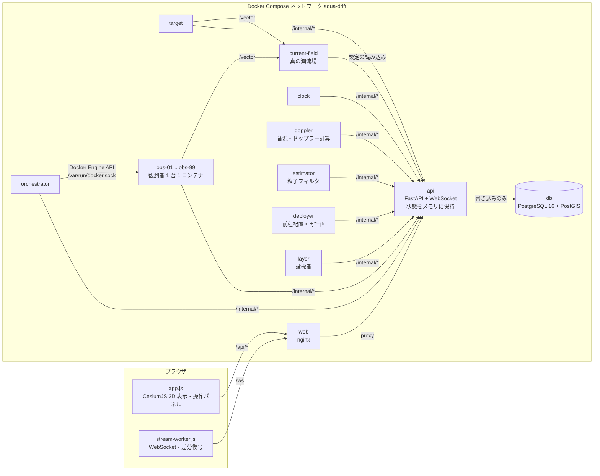
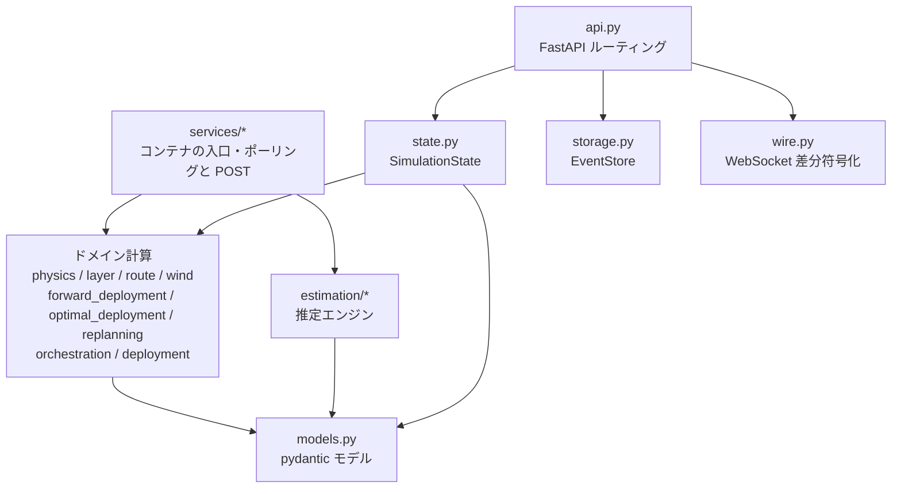
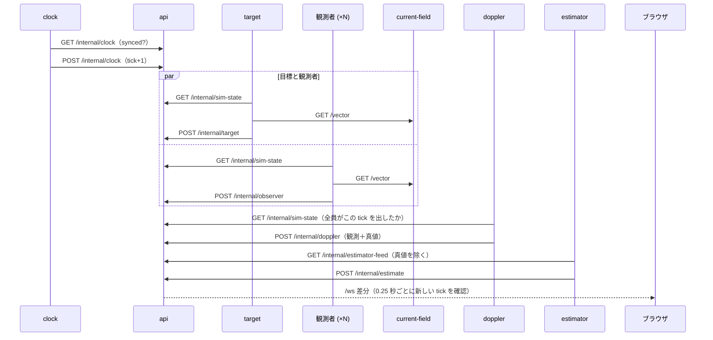
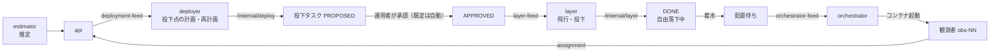
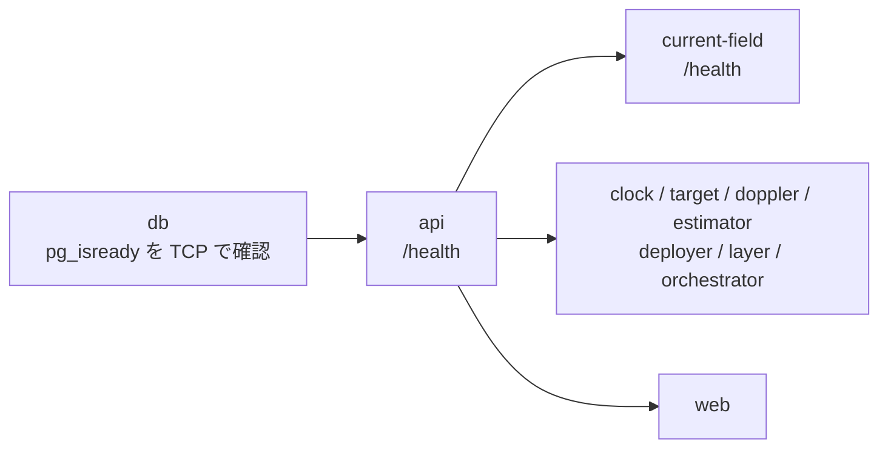

# システム構成

AQUA-DRIFT の構成要素、backend / frontend の中身、Docker の構成、データの流れをまとめます。
推定手法そのものは [estimation-methods.md](estimation-methods.md)、動作環境は
[system-requirements.md](system-requirements.md) を参照してください。

## 1. 概要

AQUA-DRIFT は、潮流に流される水中目標を、漂流する観測者（ソノブイ相当）のドップラー・方位観測から
3 次元で追尾するシミュレーターです。目標・観測者・音響計算・推定・配置計画・設標者（観測者を投下する
航空機）をそれぞれ別のコンテナで動かし、API コンテナが状態の集約と記録、Web コンテナが GIS 表示を
受け持ちます。

設計上の原則は次の 3 つです。

| 原則 | 内容 |
|---|---|
| 真値の分離 | 推定・配置計画・設標者は観測と推定値だけを受け取り、目標の真値・真の潮流・真の音源周波数を見ない |
| 1 秒刻みの同期 | 時計コンテナが 1 tick（模擬時間 1 秒）ずつ進め、全コンテナがその tick を終えるまで次へ進まない |
| API が唯一の書き手 | 各コンテナは HTTP で API に読み書きし、データベースへ書くのは API だけ |

## 2. 全体構成図

コンテナどうしは直接通信せず、すべて API を経由します（潮流ベクトルだけは `current-field` に直接
問い合わせます）。各ワーカーは API を一定間隔でポーリングし、結果を POST する単純な構造です。

## 3. 構成要素（コンテナ）

`docker-compose.yml` の定義です。`web` と `db` 以外はすべて同じ backend イメージ
（`backend/Dockerfile`、Python 3.12）から、起動コマンドだけを変えて動かします。

| サービス | 起動コマンド | 役割 | 周期 |
|---|---|---|---|
| `db` | `imresamu/postgis:16-3.4-alpine` | イベント履歴と航跡の記録（PostGIS）。amd64 / arm64 両対応のイメージ | － |
| `api` | `uvicorn aqua_drift.api:app` | 公開 API・内部 API・WebSocket。シミュレーション状態をメモリに持ち、DB に記録する | 要求ごと |
| `current-field` | `uvicorn aqua_drift.services.current_field:app` | 真の線形潮流場 `v(p) = a + G (p − p_ref)` を `/vector` で返す。設定は 1 秒ごとに API から読み直す | 要求ごと |
| `clock` | `python -m aqua_drift.services.clock` | tick を 1 つずつ進める。速度（0＝一時停止〜100 倍）は運用者が設定 | 1 tick |
| `target` | `aqua_drift.services.target` | 目標の運動（HDG・対水速力・深度、変化率の制限つき）＋潮流による移動 | 1 tick |
| `orchestrator` | `aqua_drift.services.orchestrator` | 観測者コンテナを必要なときだけ起動し、終わったら止める | 2 秒 |
| `obs-NN`（動的） | `aqua_drift.services.observer` | 観測者 1 台。水と一緒に漂流し、自分の時刻・位置・深度を正確に知る | 1 tick |
| `doppler` | `aqua_drift.services.doppler` | 目標と全観測者がその tick を出し終えるのを待ち、受信周波数・探知／非探知・方位・（任意で）受信レベルを 1 バッチで出す | 1 tick |
| `estimator` | `aqua_drift.services.estimator` | 観測だけを受け取り、ONLINE / SMOOTHED の推定、最近接（CPA）、存在圏を出す | 新しい観測ごと |
| `deployer` | `aqua_drift.services.deployer` | 推定から観測者の追加投下点（位置・数・深度・時刻）を計画し、未実施の投下を再計画する | 5 秒 |
| `layer` | `aqua_drift.services.layer` | 設標者。承認された投下点へ飛び、風の中を落下させて観測者を着水させる | 1 tick |
| `web` | nginx 1.27 | 静的ファイル（CesiumJS 同梱）と `/api/`・`/ws` の API への中継 | － |
| `observer`（任意） | `aqua_drift.services.observer` | `static-observers` プロファイルで観測者を固定台数起動する代替手段 | 1 tick |

## 4. backend（`backend/aqua_drift/`）

### 4.1 層の分け方

`services/` はネットワーク入出力だけを持ち、計算は純粋な関数・クラス（ドメイン層）に置いています。
同じ計算を `scenario.py` が 1 プロセスで回せるので、テストや解析は Docker なしで動きます。

### 4.2 モジュール一覧

| モジュール | 内容 |
|---|---|
| `api.py` | 公開 API（`/api/*`）、内部 API（`/internal/*`）、WebSocket（`/ws`） |
| `state.py` | `SimulationState`：tick、設定、目標・観測者の最新状態、観測バッチ、推定出力、投下タスク、世代（generation）を 1 つのロックで保持 |
| `storage.py` | `EventStore`：asyncpg で PostgreSQL に追記。起動時にスキーマを作成し、DB が準備中なら再試行 |
| `models.py` | 全コンテナ共通の pydantic モデル。真値（`TargetState`、`DopplerTruth`）と観測（`DopplerObservation`）を別モデルにしている |
| `physics.py` | 目標・観測者の運動、潮流、ドップラー観測（伝搬遅延、音源周波数のゆらぎ、方位誤差、ロイドミラーの受信レベル） |
| `wire.py` | GIS 向け差分プロトコル v2 の符号化（接続ごとに送信済みの内容を覚え、差分だけを送る） |
| `deployment.py` | 既定の観測者初期配置パターン |
| `forward_deployment.py` | 前程配置：推定目標の先に観測者が足りるかを判定し投下点を決める |
| `optimal_deployment.py` | 自動最適配置：変針・変速・変深の仮説に対して頑健な位置・数・深度・投下時刻 |
| `replanning.py` | 推定が動いたときの未実施投下の置き換え、探知に役立たなくなった投下の取消提案 |
| `layer.py` | 設標者の運動（基準速力、バンク角 ≤ 15°、投下前後の水平直線飛行、待機旋回） |
| `route.py` | 投下点を通る経路（Dubins 経路、通過針路の選択） |
| `wind.py` | 高度別の風と投下後の自由落下、着水ずれからの平均風推定 |
| `orchestration.py` | 観測者コンテナの起動・停止の判断（Docker に依存しない純粋関数 `plan()`） |
| `scenario.py` | 全コンテナ分の計算を 1 プロセスで回すランナー（テスト・解析・オフライン実行用） |
| `estimation/engine.py` | `TrackingEngine`：観測バッチを入れ、推定出力を返す |
| `estimation/current_fit.py` | 観測者の漂流から線形潮流場を推定 |
| `estimation/particle_filter.py` | 7 状態（位置・対水速度・周波数偏り）の正則化粒子フィルタ |
| `estimation/move.py` | resample-move（窓尤度、Levenberg–Marquardt、MH） |
| `estimation/cpa.py` | 観測者ごとの最近接解析 |
| `estimation/region.py` | 推定存在圏（最高密度領域） |
| `estimation/lloyd.py` | ロイドミラー干渉からの目標深度（任意） |
| `estimation/maneuver_timing.py` | 観測者間の変化到達時間差からの変針等の時刻推定 |
| `estimation/frame.py` | 局所接平面座標（東・北・下、メートル） |
| `analysis/*` | 実行時には使わない検討用ツール（観測方式の比較、深度推定、変針への配置、失探知、差分プロトコルのテスト用データ生成） |

## 5. frontend（`web/`）

| ファイル | 内容 |
|---|---|
| `index.html` | 画面の骨組み。タブ：推定結果、目標、観測・推定、配置・設標、風・潮流、表示 |
| `app.js` | CesiumJS の 3D 地図（Natural Earth II 画像を同梱）、航跡・存在圏・観測者・設標者の描画、操作パネル、`/api/*` の呼び出し |
| `stream-worker.js` | Web Worker。WebSocket の接続・再接続、JSON 解析、差分の統合、航跡の地心座標（XYZ）変換を行い、`Float64Array` を転送で渡す |
| `stream-decoder.js` | 差分プロトコル v2 の復号（Python の `wire.py` と対になる。CI で相互に検証） |
| `styles.css` | 画面のスタイル |
| `nginx.conf` | `/api/` と `/ws` を `api:8000` へ中継、それ以外は静的ファイル |
| `Dockerfile` | Node 22 で `cesium@1.129.0` を取得し、nginx イメージへ `Build/Cesium` と画面のファイルをコピー |

描画の重い処理（解析・座標変換）を Worker に置き、メインスレッドはポリラインやマーカーの更新と
見えているパネルの更新だけを行います。

## 6. API

### 6.1 公開 API（ブラウザ・運用者）

| メソッド・パス | 内容 |
|---|---|
| `GET/PUT /api/config` | シナリオ設定（目標、観測、推定、配置、設標者、風、潮流など） |
| `GET /api/snapshot` | 全状態の完全なスナップショット（ツール・テスト用） |
| `GET/PUT /api/clock` | 模擬速度（1＝実時間、0＝一時停止） |
| `POST /api/estimation/start`・`/stop`、`GET /api/estimation` | 推定の開始・停止 |
| `POST /api/reset` | 目標の初期状態からやり直す（履歴は DB に残す） |
| `POST /api/observers/placements` | 手動配置（設標者が有効なら投下タスクになる） |
| `POST /api/deployment/now` | 今すぐ前程配置を計画する |
| `POST /api/drops/approve`・`reject`・`cancel`・`reschedule`・`reorder` | 投下タスクの承認・却下・取消・時刻変更・順序変更 |
| `WS /ws` | GIS 向けストリーム（差分プロトコル v2、per-message deflate） |
| `GET /health` | ヘルスチェック |

### 6.2 内部 API（コンテナ間）

| パス | 呼ぶ側 | 内容 |
|---|---|---|
| `GET /internal/clock`・`POST /internal/clock` | clock | 同期状態の確認と tick の更新 |
| `GET /internal/sim-state` | target・観測者・doppler | 現在 tick、設定、目標・観測者の状態、世代 |
| `POST /internal/target` | target | 目標の状態 |
| `GET /internal/observer/assignment`・`POST /internal/observer` | 観測者 | 初期位置の割り当て（204＝待機）、状態の報告（410＝終了） |
| `GET /internal/orchestrator-feed`・`POST /internal/observers/evict-oldest` | orchestrator | 必要な観測者数、満杯時に最古の観測者を退役 |
| `POST /internal/doppler` | doppler | 観測バッチ（観測と真値） |
| `GET /internal/estimator-feed`・`POST /internal/estimate` | estimator | 真値を除いた観測、推定出力 |
| `GET /internal/deployment-feed`・`POST /internal/deploy`・`POST /internal/cancel-suggestions` | deployer | 推定と観測者位置（真値なし）、投下計画、取消提案 |
| `GET /internal/layer-feed`・`POST /internal/layer` | layer | 承認済みタスク・推定目標・推定潮流、設標者の状態と投下 |

## 7. データの流れ

### 7.1 1 tick の流れ

* `clock` は API の `synced` が真（目標・全観測者・doppler がその tick を出し、推定が 10 tick 以上
  遅れていない）になるまで次の tick を始めません。1 倍速を超える設定では、最も遅いコンテナ
  （主に推定）が実際の速さの上限になります。
* 1 倍速では tick の予定時刻をシステム時刻に固定するので、模擬時刻が実時間からずれていきません。

### 7.2 真値の分離

| データ | 誰が使うか |
|---|---|
| 目標の真の状態、`DopplerTruth`（斜距離・相対速度）、真の潮流、真の音源周波数 | 表示と評価だけ（api・ブラウザ・DB） |
| `DopplerObservation`（時刻、観測者の正確な位置・深度、探知フラグ、受信周波数、認識している音源周波数、誤差つき方位） | estimator |
| 推定値・観測者位置・投下予定 | deployer・layer |

`/internal/estimator-feed` と `/internal/deployment-feed` が真値を取り除き、`EstimatorSettings`
にも真値のパラメータを含めていません。

### 7.3 配置と設標（観測者の追加）

* 投下タスクの状態：`PROPOSED`（提案）→ `APPROVED`（承認）→ `DONE`（投下済み）。ほかに
  `REJECTED`（却下）、`CANCELLED`（取消）、`EXPIRED`（提案の期限切れ）、`REPLACED`（再計画で置換）。
* 設標者は風の中で観測者を落とします。着水点と無風時の予測着水点との差から投下高度以下の平均風を
  推定し、次の投下点の補正に使います（[wind.md](wind.md)）。
* 設標者を無効にすると、計画した位置はそのまま配置待ちになります。

### 7.4 観測者のライフサイクル

1. `orchestrator` が配置待ち＋未割り当ての初期観測者＋予備の数だけ、空いている最小番号の枠
   （`obs-01`〜`obs-99`）でコンテナを起動します（`AutoRemove`、メモリ上限 `OBSERVER_MEMORY_MB`）。
2. 観測者は `/internal/observer/assignment` で初期位置を受け取ります。204 の間は待機し、
   `OBSERVER_STANDBY_TIMEOUT_S` を過ぎると自分で終了します。
3. 漂流しながら毎 tick 状態を報告します。3 時間の上限に達するか、枠が満杯で最古として退役させられると
   410 が返り、コンテナが終了して枠が空きます（履歴は `<slot>#<session>` として残ります）。
4. `docker compose down` で `orchestrator` が SIGTERM を受けると、起動した観測者コンテナをすべて止めます。

### 7.5 リセットと世代（generation）

`POST /api/reset` で世代番号が進みます。各コンテナは計算に使った世代を付けて POST し、API は古い世代の
POST を捨てます（200 で `ignored` を返すので、コンテナは次のポーリングで新しい世代に切り替わります）。
これでリセット前の目標位置や推定が新しい実行に混ざりません。

### 7.6 GIS ストリーム

`wire.py` は接続ごとに送信済みの内容を持ち、最初のメッセージだけ完全、以降は差分（航跡の追加点、
変化した部分のみ、存在圏は最短 3 秒間隔）を丸めた配列で送ります。WebSocket は per-message deflate で
さらに圧縮されます。ブラウザ側は `stream-worker.js` が復号・統合し、メインスレッドは描画だけを行います。

## 8. 永続化

状態の正本は `api` のメモリ（`SimulationState`）で、データベースは追記専用の履歴です。実行時に DB から
読み戻すことはありません（`DATABASE_URL` が無ければ記録せずに動きます）。

| テーブル | 内容 |
|---|---|
| `scenario_config` | 最新の設定（1 行） |
| `simulation_events` | 全イベントの追記ログ（設定変更、速度変更、目標・観測者状態、観測バッチ、10 tick ごとの推定、投下の判断、リセットなど）。`(tick, event_type)` に索引 |
| `active_observers` | 稼働中の観測者 |
| `target_track` | 目標の航跡（`geometry(PointZ, 4326)`） |
| `observer_track` | 観測者の航跡（GiST 空間索引） |

データは名前付きボリューム `aqua-drift-db` に残ります。容量の見積りは
[system-requirements.md](system-requirements.md) の 2.3 節を参照してください。

## 9. Docker 構成

### 9.1 ネットワークとポート

| 項目 | 内容 |
|---|---|
| ネットワーク | 全サービスが `aqua-drift` ブリッジネットワークに参加し、サービス名で名前解決 |
| `web` | `${WEB_BIND:-0.0.0.0}:${WEB_PORT:-8090}` → 80。画面はここから開く |
| `api` | `127.0.0.1:${API_PORT:-8091}` → 8000。ホスト内からの確認・E2E 用 |
| `db`・ワーカー | ホストには公開しない |

### 9.2 起動順とヘルスチェック

* `db` のヘルスチェックは Unix ソケットではなく TCP（127.0.0.1）で行います。初回初期化中の一時サーバーを
  準備完了と誤認しないためです。
* ワーカーは共通の `x-worker` アンカー（`restart: on-failure`、`API_URL`・`CURRENT_FIELD_URL`、
  `api` の healthy 待ち）を使います。起動後も `/health` が応答するまで待ってから動き始めます。

### 9.3 観測者コンテナの起動方式

| 方式 | 起動方法 | 特徴 |
|---|---|---|
| 動的（既定） | `orchestrator` に `/var/run/docker.sock` をマウント | 必要な観測者だけコンテナが動く。自分と同じイメージ・ネットワーク・Compose プロジェクトラベルで作るので、`docker compose down --remove-orphans` でも片付く |
| 静的 | `docker compose --profile static-observers up --scale observer=N` | Docker ソケット不要。台数分のコンテナが常駐する |

Docker ソケットが無い場合、`orchestrator` は警告を出して何もしません。

### 9.4 主な環境変数（`.env`）

| 変数 | 既定値 | 内容 |
|---|---|---|
| `POSTGRES_DB`・`POSTGRES_USER`・`POSTGRES_PASSWORD` | `aqua_drift` | DB 接続 |
| `MAX_SLANT_RANGE_YD` | 6000 | 共通の最大斜距離（探知距離） |
| `ESTIMATION_AUTOSTART` | true | 起動時に推定を始めるか |
| `OBSERVER_WARM_STANDBY` | 0 | 予備として先に起動しておく観測者コンテナ数 |
| `OBSERVER_MEMORY_MB` | 192 | 観測者コンテナ 1 台のメモリ上限 |
| `OBSERVER_STANDBY_TIMEOUT_S` | 120 | 割り当てを待つ観測者コンテナが自分で終了するまでの秒数 |
| `ESTIMATOR_CPUS`・`ESTIMATOR_THREADS` | 2 | 推定コンテナの CPU 上限と数値計算スレッド数 |
| `WEB_BIND`・`WEB_PORT`・`API_PORT` | 0.0.0.0・8090・8091 | 公開アドレスとポート |
| `OBSERVER_REPLICAS` | 12 | 静的方式のときの観測者数 |

## 10. テストと CI

`.github/workflows/ci.yml` のジョブです。

| ジョブ | 内容 |
|---|---|
| `backend` | `ruff check backend`、`pytest backend/tests` |
| `compose` | `docker compose config --quiet` |
| `web` | Python の符号化器で作ったストリームを JS の復号器で復号して比較、`node --check` |
| `ui-smoke` | backend なしで Cesium の 3D 表示が headless Chromium で起動・描画するか |
| `e2e` | 全スタックを起動し、最初の推定まで待って画面を確認（`e2e/ui_check.py`）、観測者の枠の再利用（`e2e/reuse_check.py`） |
| `soak` | 全スタックを 25 分動かし、止まる部分が無いか、フレーム遅延・メモリの推移を記録 |

## 11. 関連ドキュメント

| ドキュメント | 内容 |
|---|---|
| [architecture.md](architecture.md) | 英語の構成概要 |
| [uml/](uml/) | PlantUML（コンポーネント、クラス、シーケンス、推定の流れ、観測者の状態など） |
| [system-requirements.md](system-requirements.md) | 動作環境の要件 |
| [estimation-methods.md](estimation-methods.md) | 推定手法 |
| [optimal-deployment.md](optimal-deployment.md) | 観測者の自動配置 |
| [layer-route.md](layer-route.md)・[wind.md](wind.md) | 設標者の経路、風と自由落下 |
| [requirements.md](requirements.md) | 要求事項とトレーサビリティ |
